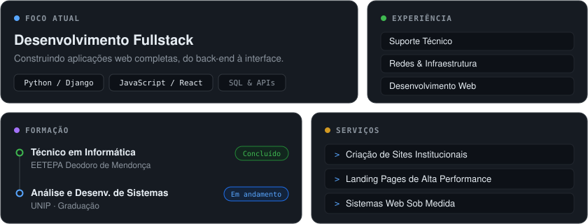

<!-- Header dinâmico minimalista -->

  Ananindeua, PA — Brasil · Disponível para projetos freelance

<!-- Links de contato -->

  
  
  

---

### Sobre mim

Formado como **Técnico em Informática** pela EETEPA Deodoro de Mendonça e graduando em **Análise e Desenvolvimento de Sistemas** pela UNIP.

Com base prática em **suporte técnico, infraestrutura e redes**, hoje direciono meu foco para o **desenvolvimento fullstack** — construindo aplicações web completas, organizadas e funcionais, do back-end à interface.

  

---

### Serviços

Além dos projetos de estudo e portfólio, atuo com **desenvolvimento sob demanda** para negócios e profissionais que precisam de presença digital ou automação:

- **Sites Institucionais & Landing Pages** — design limpo, responsivo e focado em performance.
- **Sistemas Web Sob Medida** — painéis administrativos, dashboards e aplicações fullstack com Python/Django e React.
- **Prototipação & UI** — estruturação de interfaces modernas no Figma antes de ir para o código.

> Precisa tirar um projeto do papel? Acesse [**fabiosilva.dev.br**](https://www.fabiosilva.dev.br) ou chame no [LinkedIn](https://www.linkedin.com/in/fabio-kaua) / [Instagram](https://www.instagram.com/neb.fabeo).

---

### Stack & Ferramentas

**Desenvolvimento**

  &nbsp;&nbsp;&nbsp;
  &nbsp;&nbsp;&nbsp;
  &nbsp;&nbsp;&nbsp;
  &nbsp;&nbsp;&nbsp;
  &nbsp;&nbsp;&nbsp;
  

**Banco de Dados**

  &nbsp;&nbsp;&nbsp;
  

**Infra, Ferramentas & Design**

  &nbsp;&nbsp;&nbsp;
  &nbsp;&nbsp;&nbsp;
  &nbsp;&nbsp;&nbsp;
  &nbsp;&nbsp;&nbsp;
  &nbsp;&nbsp;&nbsp;
  

